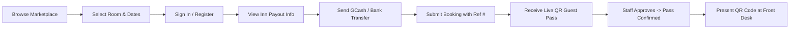
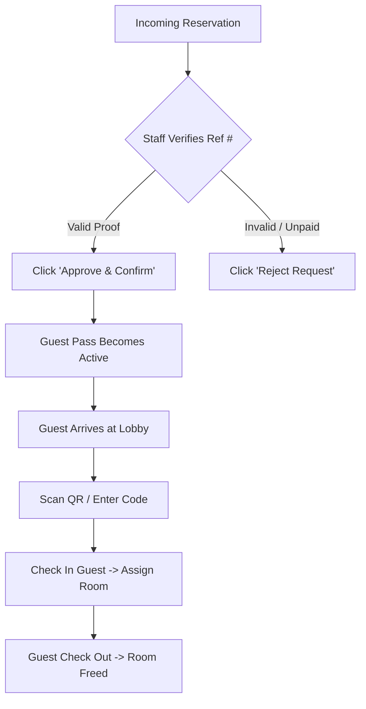

# How CheckInn (LocalStay) Works: Complete Process & User Guide

Welcome to **CheckInn (LocalStay)** — a modern, multi-tenant lodging marketplace and property management system designed for boutique hotels, heritage inns, eco-lodges, and travelers.

This document details the **end-to-end operational processes**, explaining how each user role interacts with the system, how payments and digital QR passes work, and how to operate and deploy the platform.

---

## 📑 Table of Contents
1. [Platform Roles & Access Levels](#1-platform-roles--access-levels)
2. [Process 1: The Guest Journey (Browse, Book & QR Pass)](#2-process-1-the-guest-journey)
3. [Process 2: The Front Desk Staff Journey (Verify & Check-In)](#3-process-2-the-front-desk-staff-journey)
4. [Process 3: The Hotel Owner Journey (Setup & Inventory)](#4-process-3-the-hotel-owner-journey)
5. [Process 4: Platform Super Admin Journey (Onboarding & Governance)](#5-process-4-platform-super-admin-journey)
6. [Payment & Verification Flow (GCash / Bank Transfer)](#6-payment--verification-flow)
7. [Pre-Seeded Demo Accounts for Testing](#7-pre-seeded-demo-accounts-for-testing)
8. [How to Run and Test Locally](#8-how-to-run-and-test-locally)
9. [Production Deployment Architecture (Vercel & Render)](#9-production-deployment-architecture)

---

## 1. Platform Roles & Access Levels

CheckInn operates as a **multi-role, multi-tenant** architecture:

| Role | Target User | Key Capabilities |
| :--- | :--- | :--- |
| **Guest / Traveler** | Any visitor booking a stay | Browse marketplace, compare inns, reserve rooms, submit GCash/bank payment proof, access live digital QR guest pass. |
| **Hotel Staff / Front Desk** | Front desk receptionists | Review incoming reservation requests, verify payment reference numbers, approve/reject bookings, scan QR codes for check-in/out, handle guest requests, create walk-ins. |
| **Hotel Owner / Admin** | Inn proprietors & managers | Edit inn profile, configure GCash/bank payout accounts, manage room types & pricing, add/remove physical rooms, manage staff user accounts, view revenue & occupancy analytics. |
| **Super Admin** | Platform operators | Review and approve/reject partner hotel onboarding applications, monitor nationwide platform statistics, manage global users. |

---

## 2. Process 1: The Guest Journey



### Step 1: Discovering Lodgings
1. The guest opens the homepage (`http://localhost:5173/`).
2. They can filter by **Destination** (e.g., *Malaybalay, Siargao, Boracay, Bali*), **Category** (*Mountain, Beach, City, Eco, Heritage*), or search by name.
3. Rates are dynamically converted to preferred currencies (PHP, USD, EUR, JPY, GBP).

### Step 2: Selecting a Room & Reserving
1. The guest clicks on an inn (e.g., *Pine Hills Hotel*) to view its amenities, gallery, address, and room options.
2. Under **Available Rooms**, the guest selects check-in and check-out dates.
3. Clicking **"Book This Room"** opens the Booking Modal. If not signed in, the system prompts them to log in or register.

### Step 3: Submitting Payment Proof
1. The modal displays the inn's verified **Payment Account**:
   - Payout Method: e.g. **GCash** or **Bank Transfer**
   - Account Name: e.g. *Pine Hills Hotel Inc.*
   - Account Number: e.g. *09185551002* with a convenient 1-click **Copy** button.
2. The guest transfers the total amount using their GCash or bank app.
3. The guest enters the **Payment Reference Number** (e.g., `MP-20261014-99812`) into the field.
4. Clicking **"Confirm Reservation Request"** submits the booking with status `pending_approval`.

### Step 4: Digital QR Guest Pass
1. The guest is immediately redirected to their **Digital Guest Pass**.
2. **Pending State**: The pass shows a warm amber badge `"Pending Staff Approval"`. The QR code stays locked until staff review.
3. **Confirmed State**: Once staff verify the payment reference, the pass turns emerald green `"Confirmed"`, unlocking the active QR code, check-in instructions, and direct property contact.
4. The guest can download, print, or bookmark this pass on their mobile phone without needing any app install.

---

## 3. Process 2: The Front Desk Staff Journey



### Step 1: Reviewing Pending Requests
1. Front desk staff log in and navigate to the **Staff Dashboard** (`/staff/requests`).
2. The queue displays all bookings for their specific hotel.
3. Each card shows the guest name, room type, dates, total price, and the **Payment Reference Number** badge with a copy tool.

### Step 2: Approving or Rejecting Requests
- **To Approve**: Staff checks their hotel's GCash or bank merchant portal for the reference number. Once confirmed, staff clicks **"Approve & Confirm"**. The room status is locked, avoiding double-bookings, and the guest's QR code is issued.
- **To Reject**: If the reference number is invalid or payment was not received, staff clicks **"Reject"** and provides a reason. The provisional hold on the room is immediately released.

### Step 3: Contactless QR Check-In
1. When the guest arrives at the lobby, they present their **Digital Guest Pass** on their smartphone.
2. Staff navigates to the **QR Scanner / Check-In** screen (`/staff/checkin`).
3. Staff scans the guest's QR code using the device camera or types the alphanumeric booking code.
4. The system validates the token and clicks **"Confirm Check-In"**, setting the booking to `checked_in` and assigning the physical room number.

### Step 4: Handling Walk-Ins & Check-Out
- **Walk-Ins**: For travelers arriving directly at the counter, staff uses the **"Quick Walk-In"** tab to bypass online payment verification and check the guest straight into an available room.
- **Check-Out**: When the guest checks out, staff clicks **"Check Out"** on the dashboard. The room is marked for housekeeping, and the QR pass is deactivated.

---

## 4. Process 3: The Hotel Owner Journey

Hotel owners manage their property through the **Hotel Management Portal**:

1. **Payout Account Setup (`/hotel-manage/profile`)**:
   - Owners configure their preferred payout channel: **GCash**, **Maya**, **BDO**, **BPI**, or **Metrobank**.
   - Input the Account Name and Account Number.
   - *This information automatically populates the guest booking modal for direct payments.*
2. **Room Type & Pricing Management (`/hotel-manage/room-types`)**:
   - Define suite categories (e.g., *Deluxe Pine Suite, Executive Double*).
   - Set nightly rates, maximum guest capacity, amenities list, and upload gallery photos.
3. **Physical Room Inventory (`/hotel-manage/rooms`)**:
   - Add individual room units (e.g., *Room 101, Room 102, Villa A*).
   - Track live occupancy status: `Available`, `Occupied`, or `Maintenance`.
4. **Staff Management (`/hotel-manage/staff`)**:
   - Create and manage receptionist accounts restricted to this specific property.
5. **Analytics & Performance**:
   - Track total bookings, occupancy rates, and revenue.

---

## 5. Process 4: Platform Super Admin Journey

The platform operator oversees all marketplace activity from the **Platform Admin Portal** (`/platform/hotels`):

1. **Partner Hotel Onboarding**:
   - New hotels apply via the public **"List Your Property"** portal (`/partner-register`), submitting their BIR TIN, Mayor's Business Permit number, and address.
   - Applications appear in the Super Admin review queue with status `pending`.
2. **Review & Approval**:
   - The Super Admin reviews credentials and clicks **"Approve Listing"**.
   - Upon approval, the inn instantly appears on the public marketplace, and the owner can log in to manage inventory.
3. **Nationwide Metrics**:
   - Overview of total registered inns, total rooms, gross booking volume, and active travelers across all regions.

---

## 6. Payment & Verification Flow

Because payment gateway approval in the Philippines (e.g., PayMongo, Xendit) requires formal SEC/DTI registration, CheckInn implements the high-trust **Option 1 Direct Payout & Reference Verification Flow**:

```
[Guest Mobile] ──(1. Transfer via GCash)──> [Hotel's Verified GCash Account]
     │                                                      │
(2. Enters Ref #)                                      (3. Receives SMS)
     │                                                      │
     ▼                                                      ▼
[CheckInn Backend Booking Record] <───(4. Cross-checks Ref #)─── [Hotel Staff Dashboard]
     │
(5. Staff clicks "Approve")
     │
     ▼
[Digital QR Pass Activated & Confirmed]
```

### Why this design excels:
- **Zero Platform Fees / Zero Gateway Downtime**: Guests transfer directly to the hotel; no intermediaries holding funds.
- **Prevents Double Booking**: Submitting a request places a temporary hold on the room so no other guest can select the same dates while staff verifies payment.
- **Audit Trail**: Every booking stores the transaction reference number, payout method, and timestamp.

---

## 7. Pre-Seeded Demo Accounts for Testing

The database comes pre-seeded with ready-to-test accounts:

| Role | Email | Password | Access / Scope |
| :--- | :--- | :--- | :--- |
| **Super Admin** | `admin@localstay.local` | `admin123` | Platform-wide Superuser (approves new hotels) |
| **Hotel Admin** | `admin@pinehills.local` | `admin123` | Owner of *Pine Hills Hotel* (manages rooms & staff) |
| **Front Desk Staff** | `staff@pinehills.local` | `staff123` | Receptionist at *Pine Hills Hotel* (approves bookings & scans QR) |
| **Traveler / Guest** | `guest@localstay.local` | `guest123` | Standard guest (has sample bookings & active passes) |

---

## 8. How to Run and Test Locally

### 1. Launch Both Servers in 1 Command
```bash
./start_local.sh
```
This automatically starts:
- **Backend API**: `http://localhost:8008` (Django REST Framework)
- **Frontend App**: `http://localhost:5173` (Vite + React)

### 2. Run Automated Test Suite
Run the 30 unit & integration tests covering authentication, bookings, permissions, and payment verification:
```bash
backend/venv/bin/python backend/manage.py test accounts hotels bookings
```

### 3. Verify Production Frontend Build
```bash
cd frontend && npm run build
```

---

## 9. Production Deployment Architecture

```
                       ┌──────────────────────────────────────────────┐
                       │          Vercel Edge Network                 │
                       │   React + Vite SPA + Tailwind + PWA          │
                       │   (https://localstay.vercel.app)             │
                       └──────────────────────┬───────────────────────┘
                                              │ HTTPS / JSON API
                                              ▼
                       ┌──────────────────────────────────────────────┐
                       │           Render Web Service                 │
                       │   Django 6.1 + DRF + Gunicorn + WhiteNoise   │
                       │   (https://localstay-backend.onrender.com)   │
                       └──────────────────────┬───────────────────────┘
                                              │ Connection String (DATABASE_URL)
                                              ▼
                       ┌──────────────────────────────────────────────┐
                       │         Render Managed PostgreSQL            │
                       │   Relational DB with multi-tenant FKs        │
                       └──────────────────────────────────────────────┘
```

### Quick Deploy Checklist:
1. **Push to GitHub**:
   ```bash
   git push origin main
   ```
2. **Deploy Backend (Render)**:
   - Go to [dashboard.render.com](https://dashboard.render.com/) -> **New** -> **Blueprint**.
   - Connect your GitHub repo.
   - Render automatically reads [render.yaml](file:///home/jesua/Documents/My%20Personal%20Project/CheckInn/render.yaml), provisions **Render Managed PostgreSQL**, runs [backend/build.sh](file:///home/jesua/Documents/My%20Personal%20Project/CheckInn/backend/build.sh), and starts Gunicorn.
3. **Deploy Frontend (Vercel)**:
   - Go to [vercel.com](https://vercel.com/) -> **Add New Project**.
   - Set **Root Directory** to `frontend`.
   - Add Environment Variable:
     - `VITE_API_URL` = `https://<your-render-backend-app>.onrender.com`
   - Click **Deploy**.

---
*Created for the CheckInn / LocalStay Hospitality Project (Malaybalay City & Nationwide).*
